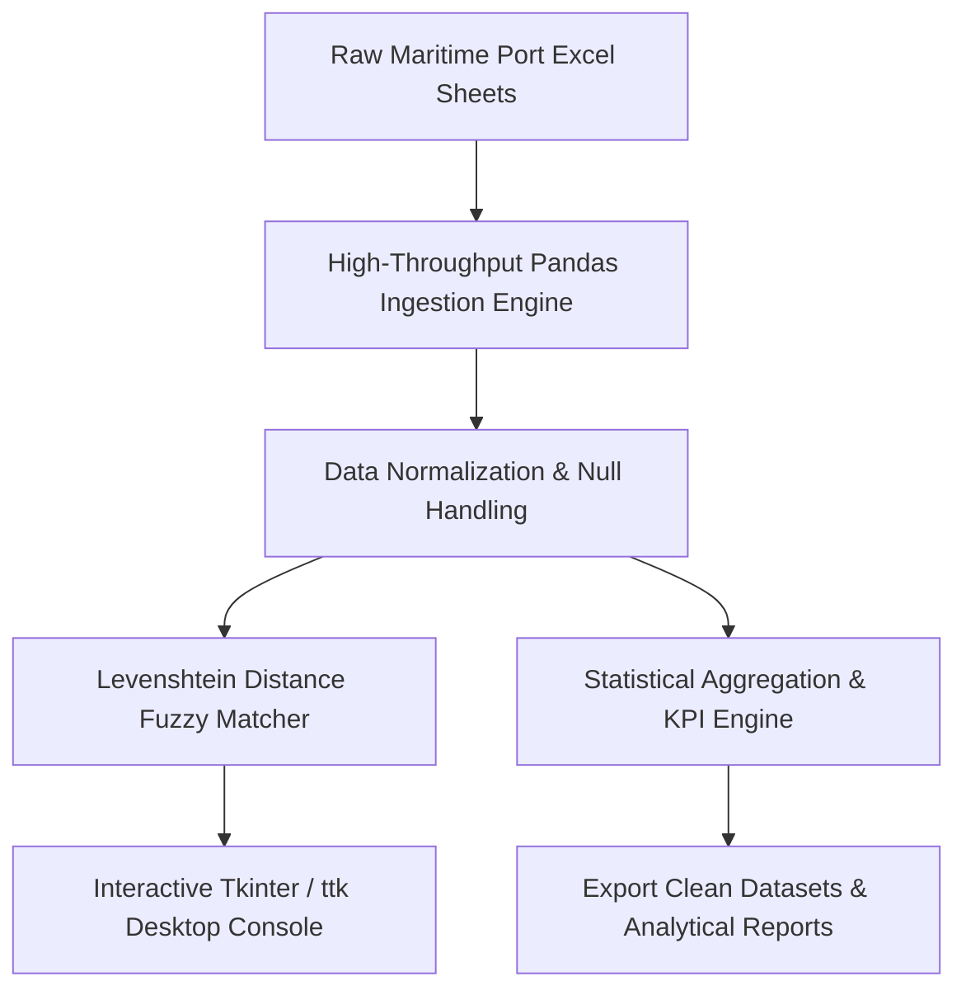

# ANP EnhancedBadgeApp - Port Logistics Intelligence & Access Control

[](https://www.python.org/)
[](https://pandas.pydata.org/)
[](https://docs.python.org/3/library/tkinter.html)
[-005596)](https://www.anp.org.ma/)
[](https://opensource.org/licenses/MIT)

An industrial data processing and logistics auditing suite engineered for the **National Ports Agency (Agence Nationale des Ports - ANP, Morocco)**. The platform streamlines port access credential verification, statistical audit generation, and batch record validation.

---

## Data Pipeline Architecture



---

## Technical Capabilities

### 1. High-Throughput Batch Processing
- Ingests and harmonizes heterogeneous spreadsheet structures containing thousands of badge entries.
- Robust schema validation with automatic type inference and exception handling.

### 2. Fault-Tolerant String Matching
- Employs fuzzy string distance metrics based on normalized Levenshtein edit distance:
  
  $$\text{similarity}(s_1, s_2) = 1 - \frac{\text{lev}(s_1, s_2)}{\max(|s_1|, |s_2|)}$$

- Enables rapid identification of badge holders despite typographical errors or phonetic transcription variants.

### 3. Desktop Analytical Console
- Modular Tkinter graphical interface optimized for low-latency search and real-time record inspection in restricted port security environments.

---

## Execution Guide

```bash
# Clone the repository
git clone https://github.com/yasmenmad/anp-projects.git
cd anp-projects

# Install required runtime dependencies
pip install -r requirements.txt

# Launch application console
python main.py
```

---

## Author & Organizational Context

- **Developer:** Yasmine Daoudi
- **Client Organization:** Agence Nationale des Ports (ANP), Kingdom of Morocco
